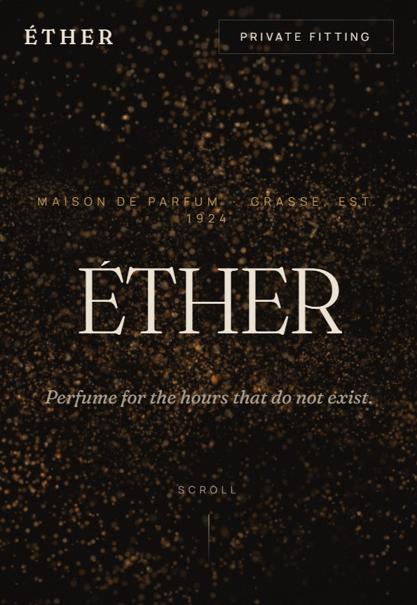

# ÉTHER

[](https://github.com/Armin0001/ether-perfume/actions/workflows/ci.yml)

**Live demo: [ether-perfume-qtox.vercel.app](https://ether-perfume-qtox.vercel.app)**

An immersive, high-performance experiential landing page for a fictional century-old perfume house from Grasse. Since fragrance exists beyond the visual, this digital experience transforms the intangible into an engaging visual journey through advanced WebGL simulations, fluid typography, and motion-driven storytelling.

Built with a strong focus on modern web performance and Core Web Vitals, balancing immersive visual experiences with efficient frontend engineering and technical optimization.

---

## 📸 Previews

<div align="center">
  
  <p><em>Desktop Experience Overview: Custom GLSL golden vapor simulation with mouse parallax.</em></p>
</div>

<details>
  <summary>📱 Click to view Mobile Responsive layout</summary>
  <br />
  <p align="center">
    
  </p>
</details>

---

## ✨ Features & Architecture

* **Custom WebGL Particle Simulation:** Driven by a custom GLSL shader utilizing layered simplex noise to drift 26,000 GPU particles behind a serif wordmark, mimicking golden vapor. Includes lerped mouse parallax.
* **Scroll-Driven Storytelling:** Powered by GSAP `ScrollSmoother`, featuring a pinned notes pyramid revealing along a growing amber rail, line-by-line masked textual reveals, and micro-interactions.
* **Vector Fidelity:** Flacons rendered as pure SVGs with precision curved shoulders and per-scent liquid gradients for infinite scaling and minimal asset payloads.

---

## 🛠️ Performance & Accessibility Engineering

Built with close adherence to Google Chrome's `modern-web-guidance` framework to ensure high-end visuals never compromise the user experience:

* **Paint-Optimized LCP:** All primary textual content is server-rendered for an instantaneous Largest Contentful Paint. The heavy Three.js context is dynamically imported asynchronously and never blocks the initial paint.
* **Hardware-Accelerated Motion:** Animations are strictly limited to composite-only properties (`transform` and `opacity`) to maintain a fluid 60fps scrolling experience without triggering layout shifts.
* **Resource Conservation:** The WebGL canvas automatically pauses calculation loops when scrolled offscreen or when the browser tab is hidden/minimized.
* **A11y & Motion Control:** Fully compliant with `prefers-reduced-motion`. Users with reduced-motion enabled bypass heavy scroll triggers entirely, receiving a graceful fallback of a static golden vapor frame alongside fully accessible content.

---

## 🧰 Tech Stack

* **Framework:** Next.js (App Router), TypeScript, Tailwind CSS
* **Graphics & Motion:** Three.js, Custom GLSL, GSAP (ScrollSmoother, SplitText)
* **Standards & Quality:** `modern-web-guidance` (Google Chrome / Provenance-Attested)

---

## 🧪 Tests

The scent catalog in [`lib/scents.ts`](lib/scents.ts) drives the statically generated scent pages, the flacon gradients and the WebGL vapor colours, so it has a contract, written as 11 [Vitest](https://vitest.dev) tests in [`lib/scents.test.ts`](lib/scents.test.ts):

* slugs are unique and URL-safe (each one becomes `/collection/<slug>`),
* every colour is a six-digit hex value that both CSS and `THREE.Color` accept,
* every scent has a top, heart and base tier, a price and the copy its page renders,
* the previous / next links on a scent page wrap around at both ends of the collection.

```bash
npm test
```

CI ([`.github/workflows/ci.yml`](.github/workflows/ci.yml)) runs ESLint, the TypeScript check, the tests and a production build on every push and pull request.

---

## 🚀 Getting Started

### Prerequisites
Node.js 20.9 or newer (what Next.js 16 requires).

### Installation

```bash
git clone https://github.com/Armin0001/ether-perfume.git
cd ether-perfume
npm install
npm run dev        # http://localhost:3000
```

### Other commands

```bash
npm run build      # production build (all pages are pre-rendered)
npm run lint       # ESLint
npm run typecheck  # TypeScript, no emit
npm test           # unit tests
```

---

## 📄 License

[MIT](LICENSE)
