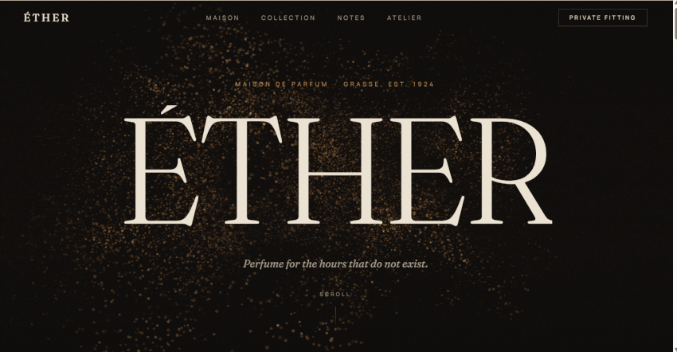

# ÉTHER — Haute Parfumerie Experience

An immersive, high-performance experiential landing page for a fictional century-old Grasse perfume house. Because scent is invisible, this digital experience translates the sensory into the visual using advanced WebGL simulations, fluid typography, and motion storytelling.

Developed with a strict focus on modern web performance and core web vitals, achieving a flawless balance between creative frontend engineering and technical optimization.

---

## 📸 Previews

<div align="center">
  
  <p><em>Desktop Experience Overview: Custom GLSL golden vapor simulation with mouse parallax.</em></p>
</div>

<details>
  <summary>📱 Click to view Mobile Responsive layout</summary>
  <br />
  <p align="center">
    
  </p>
</details>

---

## ✨ Features & Architecture

* **Custom WebGL Particle Simulation:** Driven by a custom GLSL shader utilizing layered simplex noise to drift 26,000 GPU particles behind a serif wordmark, mimicking golden vapor. Includes lerped mouse parallax.
* **Scroll-Driven Storytelling:** Powered by GSAP `ScrollSmoother`, featuring a pinned notes pyramid revealing along a growing amber rail, line-by-line masked textual reveals, and micro-interactions.
* **Vector Fidelity:** Flacons rendered as pure SVGs with precision curved shoulders and per-scent liquid gradients for infinite scaling and minimal asset payloads.

---

## 🛠️ Performance & Accessibility Engineering

Built with close adherence to Google Chrome's `modern-web-guidance` framework to ensure high-end visuals never compromise the user experience:

* **Paint-Optimized LCP:** All primary textual content is server-rendered for an instantaneous Largest Contentful Paint. The heavy Three.js context is dynamically imported asynchronously and never blocks the initial paint.
* **Hardware-Accelerated Motion:** Animations are strictly limited to composite-only properties (`transform` and `opacity`) to maintain a fluid 60fps scrolling experience without triggering layout shifts.
* **Resource Conservation:** The WebGL canvas automatically pauses calculation loops when scrolled offscreen or when the browser tab is hidden/minimized.
* **A11y & Motion Control:** Fully compliant with `prefers-reduced-motion`. Users with reduced-motion enabled bypass heavy scroll triggers entirely, receiving a graceful fallback of a static golden vapor frame alongside fully accessible content.

---

## 🧰 Tech Stack

* **Framework:** Next.js (App Router), TypeScript, Tailwind CSS
* **Graphics & Motion:** Three.js, Custom GLSL, GSAP (ScrollSmoother, SplitText)
* **Standards & Quality:** `modern-web-guidance` (Google Chrome / Provenance-Attested)

---

## 🚀 Getting Started

### Prerequisites
Ensure you have Node.js installed on your machine.

### Installation
1. Clone the repository:
   ```bash
   git clone [https://github.com/your-username/ether-parfumerie.git](https://github.com/your-username/ether-parfumerie.git)
   cd ether-parfumerie